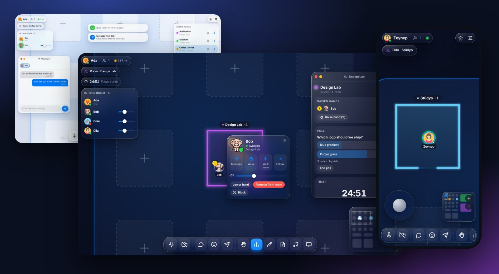
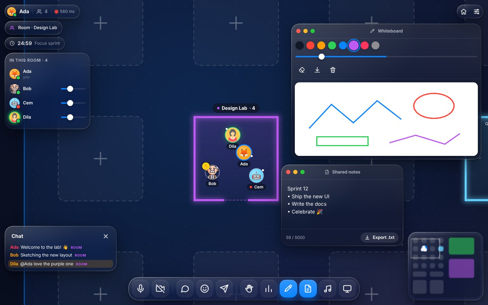
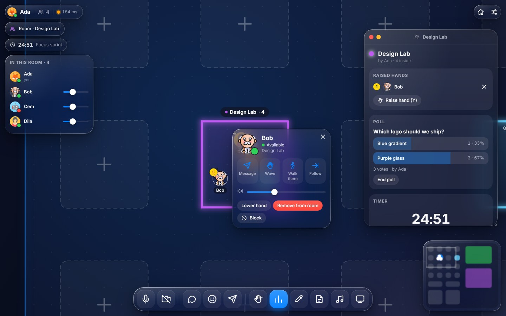
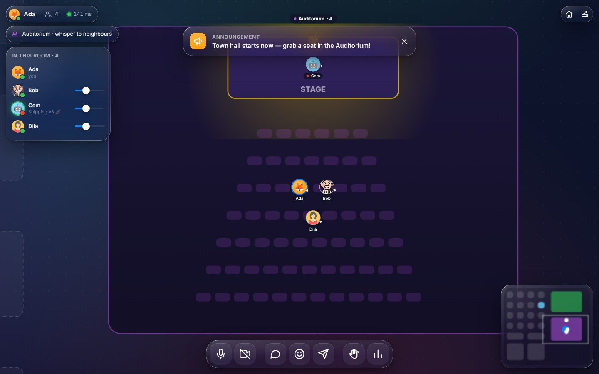
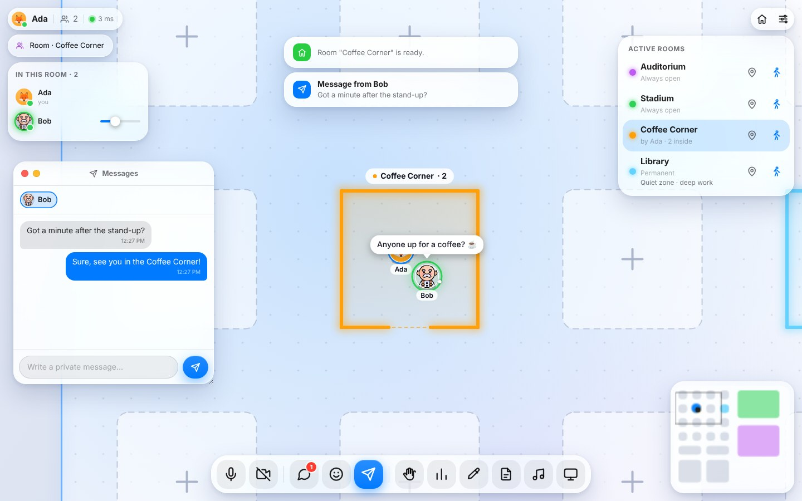
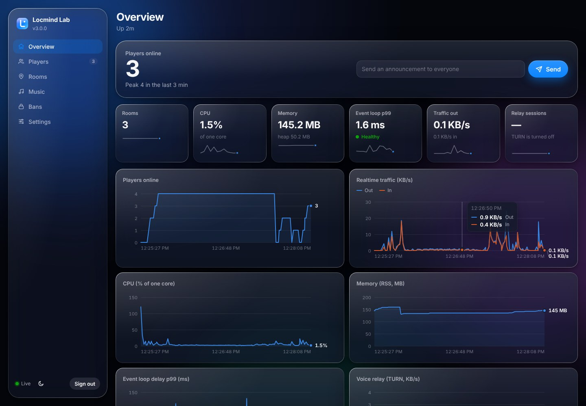
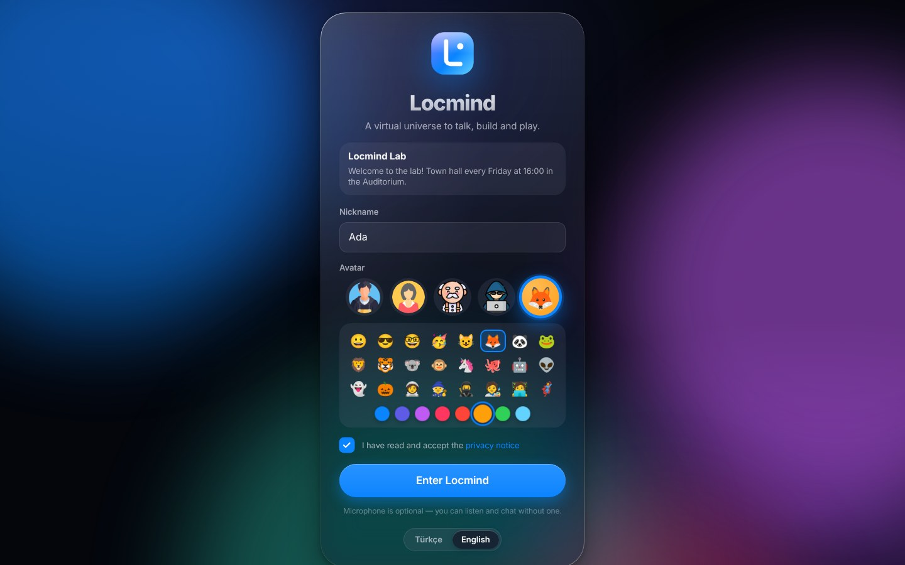
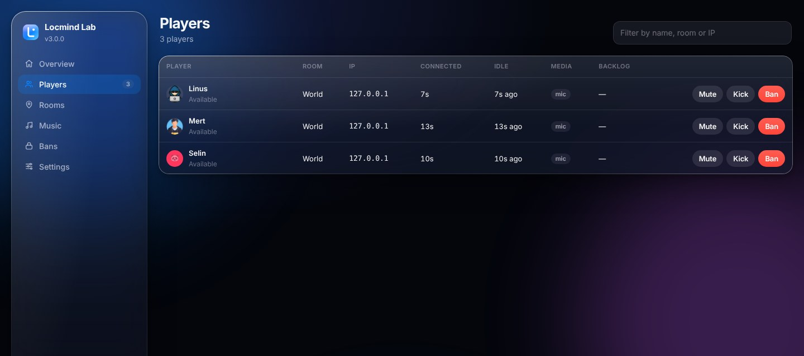
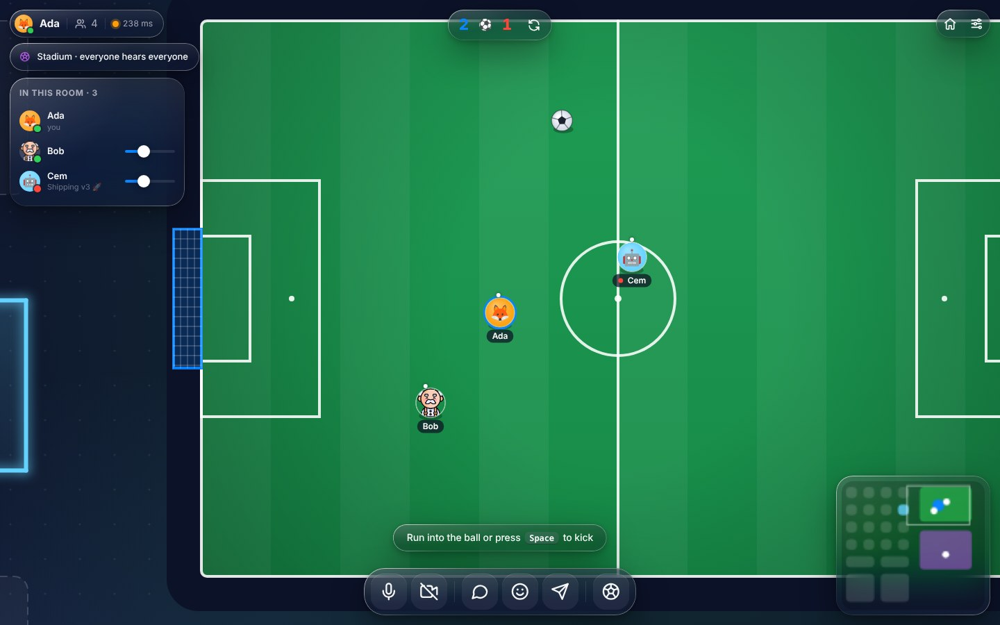
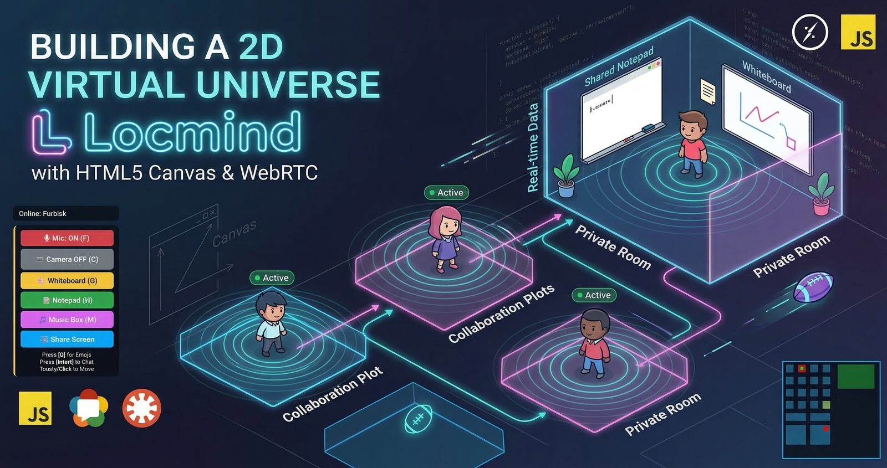

<div align="center">

# 🌌 Locmind

**A self-hosted 2D virtual universe: proximity voice, video, rooms, whiteboards, music and football — in the browser.**<br>
**One Node.js process. Zero dependencies. Your server, your data.**




[🇬🇧 English](#-english) · [🇹🇷 Türkçe](#-türkçe)

</div>

---

## 🇬🇧 English

Locmind is a 2D world you walk around in with an avatar. **You hear people louder as you get closer**,
build private rooms, draw on a shared whiteboard, run polls, give talks on a stage, listen to music
together or kick a ball around the stadium. It is made for teams, classes and communities that want
their own place on the internet — on a server they control.

```bash
git clone https://github.com/furkiak/locmind.git && cd locmind && node server.js
```

That is the whole installation. No `npm install`, no database, no Redis, no coturn, no CDN, no analytics.

### 🧱 Everything is built in

| | |
| :-- | :-- |
| 🌐 **Web server** | HTTP router and static file server with brotli / gzip, ETags and range requests. |
| ⚡ **Realtime** | Its own RFC 6455 WebSocket server and a small realtime hub (rooms, acknowledgements, back pressure, flood guard). |
| 📞 **STUN / TURN relay** | A built-in relay (UDP, TCP and TLS) with short-lived credentials, so voice works behind strict firewalls and mobile networks. |
| 🔒 **HTTPS** | Use your certificate, or let Locmind generate a self-signed one for a LAN. |
| 🛠️ **Admin panel** | Live dashboard, moderation, permanent rooms, music library, settings — at `/admin`. |
| 💾 **Persistence** | Secrets, bans, settings and permanent rooms in a plain data folder. |
| 📈 **Observability** | Prometheus metrics, JSON logs, health checks, a load test tool. |

### ✨ Features

| | |
| :-- | :-- |
| 🔊 **Spatial voice** | Proximity chat with distance falloff and stereo panning, per-person volume, push-to-talk (hold **V**), speaking rings, mic level meter. |
| 🎤 **Auditorium** | Step on the stage and the whole hall hears you; the audience only whispers to neighbours. Raise hands, share your screen from the stage. |
| 🏠 **Rooms** | Build a room on any free plot with a name, colour, topic and optional password. Owners rename it, change the password and remove people. |
| 🙋 **Meeting tools** | Raise-hand queue, live polls, a shared countdown timer, whiteboard (PNG export), shared notes (`.txt` export). |
| 📹 **Video & screens** | Camera bubbles above avatars, a camera gallery, screen sharing in draggable windows. |
| 💬 **Social** | Chat with history, direct messages, waves, @mentions, typing indicator, reactions and stickers, announcements, desktop notifications. |
| 🧑‍🎨 **Profiles** | Status (available, busy, away, do not disturb), a status line and an emoji avatar maker. Click anyone for their card: message, wave, walk there, follow, block. |
| 🧭 **Path finding** | Click anywhere — on the map, the minimap or in the room directory — and your avatar walks around walls and through doors. |
| 🎵 **Music** | A synced jukebox per room from your own library: drop files into `media/music` or let people upload songs. YouTube can be switched on. |
| ⚽ **Football** | A stadium with server side physics, dribbling, a scoreboard and goal celebrations. |
| 🪟 **Liquid Glass UI** | A macOS-style translucent interface with a magnifying dock, traffic-light windows, light and dark appearance. |
| 📱 **Mobile & PWA** | Joystick, tap to walk, pinch zoom, bottom sheets; installable, with an offline app shell. |
| 🌍 **Türkçe & English** | Follows the browser, switchable at any time. |
| 🔁 **Seamless reconnect** | A network hiccup puts you back where you were: same room, still the owner, doors still unlocked. |

### 🖼️ Screenshots

<table>
  <tr>
    <td width="50%"></td>
    <td width="50%"></td>
  </tr>
  <tr>
    <td width="50%"></td>
    <td width="50%"></td>
  </tr>
  <tr>
    <td width="50%"></td>
    <td width="50%"></td>
  </tr>
  <tr>
    <td width="50%"></td>
    <td width="50%"></td>
  </tr>
</table>

### 🚀 Quick start

Requirement: **Node.js 20 or newer**. Nothing else.

```bash
git clone https://github.com/furkiak/locmind.git
cd locmind
node server.js            # or: npm start
```

Open <http://localhost:3000>, choose a name and an avatar and you are in. The first start prints an
**admin token** (also saved in `data/secrets.json`); sign in with it at <http://localhost:3000/admin>.

> **Microphones need HTTPS.** Browsers only allow the microphone, camera and screen sharing on
> `https://` pages or on `localhost`. See [Self-hosting](#-self-hosting) below. Without a microphone
> you can still join, listen and chat.

**Docker**

```bash
docker compose up -d
docker compose logs locmind | grep -i "admin token"
```

### 🏡 Self-hosting

**1. Open the ports**

| Port | Protocol | What for |
| :-- | :-- | :-- |
| `3000` (or `443`) | TCP | The web app and its WebSocket |
| `3478` | UDP + TCP | STUN / TURN |
| `5349` | TCP | TURN over TLS (when HTTPS is on) |
| `49160–49359` | UDP | Relay ports (`TURN_RELAY_PORTS`) |

```bash
sudo ufw allow 443/tcp && sudo ufw allow 3478 && sudo ufw allow 5349/tcp && sudo ufw allow 49160:49359/udp
```

**2. Turn on HTTPS** — pick one:

- **Built in.** Get a certificate (for example `sudo certbot certonly --standalone -d locmind.example.com`)
  and start with `PORT=443 TLS_CERT=/etc/letsencrypt/live/locmind.example.com/fullchain.pem TLS_KEY=/etc/letsencrypt/live/locmind.example.com/privkey.pem`.
  The same certificate secures TURN over TLS.
- **On a LAN.** `TLS_SELF_SIGNED=true` generates a certificate in `data/tls/` (browsers will ask you to accept it once).
- **Behind a reverse proxy.** Use [`deploy/nginx.conf`](deploy/nginx.conf) or [`deploy/Caddyfile`](deploy/Caddyfile)
  and start Locmind with `TRUST_PROXY=1`. TURN ports go to Locmind directly.

**3. Tell the relay its address.** Locmind advertises the address of the machine's network
interface. On machines behind NAT (most cloud VMs) set `TURN_PUBLIC_IP` to the public IP — the log
warns you when it is needed. Test it with two browsers and `?relay=1` in the URL, which forces every
call through the relay.

**4. Run it as a service** with the hardened systemd unit in [`deploy/locmind.service`](deploy/locmind.service)
(unprivileged user, state in `/var/lib/locmind`, may bind to 443 without root):

```bash
sudo useradd --system --home /opt/locmind --shell /usr/sbin/nologin locmind
sudo cp -r . /opt/locmind && sudo cp deploy/locmind.service /etc/systemd/system/
sudo systemctl enable --now locmind && journalctl -u locmind | grep -i "admin token"
```

**5. Back up** the data folder (`DATA_DIR`) and your music folder (`MEDIA_DIR`). **Update** with
`git pull` and a restart; there is nothing to install.

### ⚙️ Configuration

Every setting can be an environment variable (`PORT=8080`), a flag (`--port 8080`) or a key in
`locmind.json`. Priority: flags › environment › `locmind.json` › defaults. A commented list lives in
[`.env.example`](.env.example) (`node --env-file=.env server.js`).

| Setting | Default | Description |
| :-- | :-- | :-- |
| `PORT` / `HOST` | `3000` / `0.0.0.0` | Web listener |
| `SERVER_NAME` | `Locmind` | Shown on the sign-in screen and in the admin panel |
| `SERVER_PASSWORD` | – | Everybody needs it to join (can also be set in the admin panel) |
| `MAX_PLAYERS` | `150` | Simultaneous players |
| `AFK_LIMIT_MINUTES` | `30` | Idle time before a 45 s "are you still there?" countdown |
| `ADMIN_TOKEN` | generated | Admin panel token; generated and stored in `DATA_DIR/secrets.json` when empty |
| `DATA_DIR` | `./data` | Secrets, bans, settings, permanent rooms, generated certificates |
| `MEDIA_DIR` | `./media` | Music library: `music/` (yours) and `uploads/` (players') |
| `ALLOW_UPLOADS` | `true` | Players may upload songs (can be changed in the admin panel) |
| `UPLOAD_MAX_MB` / `UPLOAD_QUOTA_MB` | `25` / `1024` | Size of one upload / of all uploads |
| `TLS_CERT` / `TLS_KEY` | – | Serve HTTPS (and TURN over TLS) with this certificate |
| `TLS_SELF_SIGNED` | `false` | Generate a self-signed certificate |
| `TURN` | `true` | Built-in STUN / TURN relay |
| `TURN_PORT` / `TURN_TLS_PORT` | `3478` / `5349` | Relay ports |
| `TURN_RELAY_PORTS` | `49160-49359` | UDP range for relayed media |
| `TURN_PUBLIC_IP` / `TURN_HOST` | interface address / page host | Address of the relay as clients see it |
| `TURN_SECRET` | generated | Secret for the short-lived relay credentials |
| `TURN_ALLOW_PRIVATE_PEERS` | `false` | Allow relaying to private networks (only for LAN-only setups) |
| `TURN_MAX_ALLOCATIONS_PER_IP` / `TURN_BANDWIDTH_KBPS` | `10` / `4000` | Relay quotas |
| `TURN_URL`, `TURN_USERNAME`, `TURN_CREDENTIAL` | – | Use an external TURN server as well |
| `ICE_SERVERS` | – | JSON array that replaces every ICE server |
| `EXTERNAL_STUN` | `false` | Also offer Google's public STUN server |
| `TRUST_PROXY` | `false` | `true` / number of reverse proxies in front (reads `X-Forwarded-*`) |
| `CORS_ORIGIN` | same origin | Other origins allowed to open a WebSocket |
| `MAX_CONNECTIONS_PER_IP` | `16` | Open connections per address |
| `YOUTUBE` | `false` | YouTube links and search in the music box (talks to YouTube / Invidious) |
| `INVIDIOUS_INSTANCES` | public list | Search back ends when YouTube is on |
| `LOG_LEVEL` / `LOG_FORMAT` | `info` / auto | `debug`…`error`, `pretty` or `json` |
| `METRICS` | `true` | Prometheus metrics at `/metrics` (localhost or admin token) |

### 🎮 Controls

| Key | Action |
| :-- | :-- |
| **W A S D** / **arrows** | Walk — or click, tap or drag on the map, or click the minimap |
| **Enter** · **T** · **N** | Chat · chat history · direct messages |
| **F** · **V** · **C** | Mute · push to talk (hold, when enabled in Settings) · camera |
| **Q** | Reactions and stickers |
| **E** | Build a room on a free plot |
| **G** · **H** · **M** | Whiteboard · notes · music (in a room) |
| **O** · **Y** | Room tools (polls, timer, owner settings) · raise hand |
| **R** · **P** · **L** | Room directory · your profile · camera gallery |
| **Space** | Kick the ball in the stadium |
| **+** / **−** / wheel / pinch | Zoom |
| **Esc** | Close the top-most panel, or leave a text field |

Click a person for their card. On touch screens use the joystick, the dock and the hint bubble.

### 🛠️ Admin panel

Open `/admin` and sign in with the admin token.

- **Overview:** players online, CPU, memory, event loop delay, realtime traffic and relay usage as live
  charts with a data table, system and relay details, and an announcement box that reaches everyone.
- **Players:** who is where, since when, with which devices; mute in chat, kick with a message, ban by IP for a while or for good.
- **Rooms:** create permanent rooms (they survive restarts and keep their whiteboard and notes), close any room.
- **Music:** the library with preview and delete, upload storage usage.
- **Bans** and **Settings:** message of the day, server password, uploads on/off, word filter.

Everything the panel does is also an HTTP API (`/api/admin/*`, `Authorization: Bearer <token>`).

### 📈 Performance

Measured with the built-in load test on a 4 vCPU virtual machine (players walking, chatting and
pinging like real browsers, a third of them crowded in one area). Details in [PERFORMANCE.md](PERFORMANCE.md).

| Players | Server CPU | Memory | Event loop p99 | Traffic per player |
|---:|---:|---:|---:|---:|
| 100 | 8 % of one core | 74 MB | 2.3 ms | 12.6 KB/s |
| 400 | 20 % of one core | 109 MB | 8.6 ms | 27.4 KB/s |
| 800 | 44 % of one core | 117 MB | 29.2 ms | 29.6 KB/s |

Voice and video do not pass through the server (peer to peer, or relayed when necessary), so they do
not count against these numbers. Run it yourself with `npm run bench`.

### 🛡️ Security

Origin-checked WebSockets, per-event validation and rate limits, flood and slow-client protection,
strict Content-Security-Policy, constant-time secret comparison with brute-force lockout, scrypt room
passwords, upload sniffing and quotas, a relay that refuses private networks, proxy-aware address
handling, and a fuzz test suite. Read [SECURITY.md](SECURITY.md) for the threat model and a hardening
checklist, and use GitHub's private vulnerability reporting for anything you find.

### 🗂️ Architecture

```text
server.js                 entry point: configuration, listen, graceful shutdown
src/
  app.js                  wires everything: HTTP routes, admin API, TURN, game, metrics
  config.js  log.js       layered configuration · pretty / JSON logging
  http/                   router, static files, self-signed certificate generator
  net/                    WebSocket frames, server and client, the realtime hub
  turn/                   STUN message codec and the TURN relay
  game/                   realtime game: context, admin operations, handlers/ (core, social,
                          rooms, tools, music, football, rtc)
  world.js  football.js   authoritative state: players, rooms, occupancy, tools, ball physics
  music.js  library.js    per-room queue · self-hosted music library and uploads
  moderation.js store.js  bans and runtime settings · atomic JSON persistence
  metrics.js security.js  metrics history and Prometheus · sanitising, hashing, rate limits, headers
shared/world.js           map, constants and collision geometry used by server and browser
public/                   the client: index.html, css/, js/ (ES modules), admin/, sw.js
deploy/                   systemd unit, nginx and Caddy examples
scripts/                  bench.mjs (load test), screenshots.mjs
test/                     node:test suites (unit, protocol, features, TURN, WebSocket, fuzz) and e2e/
```

- The **server is authoritative**: movement is checked against a speed budget and swept wall
  collision, rooms and their passwords live on the server, room tools only reach the people inside.
- **Interest management** sends nearby movement 20 times a second (slower in big crowds) and
  everything else twice a second, as compact `[id, x, y, direction]` rows encoded once per audience.
- **WebRTC** links are opened on demand: `audio` for everybody in earshot, `camera` one way to
  viewers in earshot, `screen` one way to everybody in the room. Signalling travels over the game socket.
- `shared/world.js` is loaded by both sides, so the map and the rules can never drift apart.

<details>
<summary>HTTP endpoints</summary>

| Endpoint | |
| :-- | :-- |
| `GET /healthz` | Liveness, version, players, uptime |
| `GET /api/config` | Public server settings for the sign-in screen |
| `GET /api/music/library` · `POST /api/music/upload` · `GET /media/music/:id` | Music library (player token) |
| `GET /metrics` | Prometheus metrics (localhost or admin token) |
| `POST /api/admin/login` · `GET /api/admin/overview` | Admin session check · dashboard data |
| `GET /api/admin/players` · `POST /api/admin/players/:id/{kick,ban,mute}` | Moderation |
| `GET/POST /api/admin/rooms` · `DELETE /api/admin/rooms/:id` | Permanent rooms |
| `GET /api/admin/bans` · `DELETE /api/admin/bans/:id` | Bans |
| `PUT /api/admin/settings` · `POST /api/admin/announce` | Settings · announcements |
| `GET /api/admin/music` · `DELETE /api/admin/music/:id` | Library management |
</details>

### 🧪 Tests

```bash
npm test               # unit, protocol, feature, TURN, WebSocket and fuzz tests (no browser, no install)
npm run test:e2e       # real Chromium browsers: voice, rooms, tools, DMs, admin panel, TURN relay, mobile
npm run bench          # load test
npm run screenshots    # regenerates docs/*.jpg
```

The browser tests need Chromium: `npm install` (dev only) and `npx playwright-core install chromium`,
or point `CHROMIUM_PATH` at an existing Chrome.

### 🗺️ Ideas

An SFU mode for very large stage events · a map editor · single sign-on · more mini games.

---

## 🇹🇷 Türkçe

Locmind, avatarınla dolaştığın 2D bir dünya. **İnsanlara yaklaştıkça onları daha yüksek duyarsın**;
özel odalar kurar, ortak beyaz tahtaya çizer, anket yapar, sahnede konuşma yapar, birlikte müzik
dinler ya da stadyumda top oynarsın. Kendi sunucusunda, kendi kontrolünde bir buluşma yeri isteyen
ekipler, sınıflar ve topluluklar için yapıldı.

```bash
git clone https://github.com/furkiak/locmind.git && cd locmind && node server.js
```

Kurulum bu kadar. `npm install` yok, veritabanı yok, Redis yok, coturn yok, CDN yok, analitik yok.

### 🧱 Her şey içinde

| | |
| :-- | :-- |
| 🌐 **Web sunucusu** | Brotli / gzip, ETag ve aralık istekleri destekleyen yönlendirici ve statik dosya sunucusu. |
| ⚡ **Gerçek zamanlı** | Kendi RFC 6455 WebSocket sunucusu ve küçük bir gerçek zamanlı merkez (odalar, onaylar, geri basınç, taşma koruması). |
| 📞 **STUN / TURN aktarıcı** | Yerleşik aktarıcı (UDP, TCP ve TLS), kısa ömürlü kimlik bilgileriyle; sıkı güvenlik duvarlarının ve mobil ağların arkasında da ses çalışır. |
| 🔒 **HTTPS** | Kendi sertifikanı kullan ya da yerel ağ için Locmind kendinden imzalı bir sertifika üretsin. |
| 🛠️ **Yönetim paneli** | Canlı gösterge paneli, moderasyon, kalıcı odalar, müzik kitaplığı, ayarlar — `/admin` adresinde. |
| 💾 **Kalıcılık** | Gizli anahtarlar, yasaklar, ayarlar ve kalıcı odalar düz bir veri klasöründe. |
| 📈 **İzlenebilirlik** | Prometheus metrikleri, JSON günlükler, sağlık kontrolleri, yük testi aracı. |

### ✨ Özellikler

| | |
| :-- | :-- |
| 🔊 **Uzamsal ses** | Mesafeyle azalan, stereo konumlu yakınlık sesi; kişi başına ses seviyesi, bas-konuş (**V** basılı), konuşma halkaları, mikrofon seviye göstergesi. |
| 🎤 **Oditoryum** | Sahneye çık, tüm salon seni duysun; dinleyiciler yalnızca yanındakilerle fısıldaşır. El kaldır, sahneden ekran paylaş. |
| 🏠 **Odalar** | Boş bir arsaya ad, renk, konu ve isteğe bağlı şifreyle oda kur. Oda sahibi adını ve şifresini değiştirir, kişileri odadan çıkarır. |
| 🙋 **Toplantı araçları** | El kaldırma sırası, canlı anketler, ortak geri sayım, beyaz tahta (PNG), ortak notlar (`.txt`). |
| 📹 **Görüntü ve ekran** | Avatarların üstünde kamera baloncukları, kamera galerisi, sürüklenebilir pencerelerde ekran paylaşımı. |
| 💬 **Sosyal** | Geçmişli sohbet, özel mesajlar, el sallama, @bahsetme, yazıyor göstergesi, tepkiler ve çıkartmalar, duyurular, masaüstü bildirimleri. |
| 🧑‍🎨 **Profiller** | Durum (müsait, meşgul, uzakta, rahatsız etmeyin), durum yazısı ve emoji avatar yapıcı. Birine tıkla, kartı açılsın: mesaj, el salla, oraya yürü, takip et, engelle. |
| 🧭 **Yol bulma** | Haritada, mini haritada ya da oda rehberinde ("Beni oraya götür") bir yere tıkla; avatarın duvarların etrafından ve kapılardan geçerek yürür. |
| 🎵 **Müzik** | Her oda için senkron müzik kutusu, kendi kitaplığından: dosyaları `media/music` klasörüne at ya da oyuncuların şarkı yüklemesine izin ver. İstersen YouTube'u açabilirsin. |
| ⚽ **Futbol** | Sunucu tarafı fiziği, top sürme, skor tabelası ve gol kutlamalarıyla stadyum. |
| 🪟 **Liquid Glass arayüz** | Büyüyen dock, trafik ışıklı pencereler, açık ve koyu görünümle macOS tarzı yarı saydam arayüz. |
| 📱 **Mobil ve PWA** | Joystick, dokunarak yürüme, iki parmakla yakınlaştırma, alt sayfalar; ana ekrana eklenebilir, çevrim dışı uygulama kabuğu. |
| 🌍 **Türkçe ve İngilizce** | Tarayıcı diline uyar, istediğin an değiştirebilirsin. |
| 🔁 **Kesintisiz yeniden bağlanma** | Bağlantı koparsa kaldığın yere dönersin: aynı oda, hâlâ sahibisin, açtığın kapılar açık. |

### 🖼️ Ekran görüntüleri

<table>
  <tr>
    <td width="50%"></td>
    <td width="50%"></td>
  </tr>
  <tr>
    <td width="50%"></td>
    <td width="50%"></td>
  </tr>
  <tr>
    <td width="50%"></td>
    <td width="50%"></td>
  </tr>
  <tr>
    <td width="50%"></td>
    <td width="50%"></td>
  </tr>
</table>

### 🚀 Hızlı başlangıç

Gereksinim: **Node.js 20 veya üstü**. Başka hiçbir şey.

```bash
git clone https://github.com/furkiak/locmind.git
cd locmind
node server.js            # ya da: npm start
```

<http://localhost:3000> adresini aç, bir ad ve avatar seç, içeridesin. İlk açılışta bir **yönetici
anahtarı** yazdırılır (ayrıca `data/secrets.json` içine kaydedilir); bununla
<http://localhost:3000/admin> adresinden giriş yaparsın.

> **Mikrofon HTTPS ister.** Tarayıcılar mikrofon, kamera ve ekran paylaşımına yalnızca `https://`
> sayfalarda ya da `localhost` üzerinde izin verir. Aşağıdaki [Kendi sunucunda](#-kendi-sunucunda)
> bölümüne bak. Mikrofonsuz da katılıp dinleyebilir ve yazışabilirsin.

**Docker**

```bash
docker compose up -d
docker compose logs locmind | grep -i "admin token"
```

### 🏡 Kendi sunucunda

**1. Portları aç**

| Port | Protokol | Ne için |
| :-- | :-- | :-- |
| `3000` (ya da `443`) | TCP | Web uygulaması ve WebSocket |
| `3478` | UDP + TCP | STUN / TURN |
| `5349` | TCP | TLS üzerinden TURN (HTTPS açıkken) |
| `49160–49359` | UDP | Aktarım portları (`TURN_RELAY_PORTS`) |

```bash
sudo ufw allow 443/tcp && sudo ufw allow 3478 && sudo ufw allow 5349/tcp && sudo ufw allow 49160:49359/udp
```

**2. HTTPS'i aç** — birini seç:

- **Yerleşik.** Bir sertifika al (örneğin `sudo certbot certonly --standalone -d locmind.example.com`)
  ve `PORT=443 TLS_CERT=/etc/letsencrypt/live/locmind.example.com/fullchain.pem TLS_KEY=/etc/letsencrypt/live/locmind.example.com/privkey.pem`
  ile başlat. Aynı sertifika TLS üzerinden TURN'ü de korur.
- **Yerel ağda.** `TLS_SELF_SIGNED=true`, `data/tls/` içinde bir sertifika üretir (tarayıcı bir kez onay ister).
- **Ters vekil arkasında.** [`deploy/nginx.conf`](deploy/nginx.conf) ya da [`deploy/Caddyfile`](deploy/Caddyfile)
  kullan ve Locmind'i `TRUST_PROXY=1` ile başlat. TURN portları doğrudan Locmind'e gider.

**3. Aktarıcıya adresini söyle.** Locmind makinenin ağ arayüzündeki adresi duyurur. NAT arkasındaki
makinelerde (bulut sunucularının çoğu) `TURN_PUBLIC_IP` değerini genel IP adresi yap — gerektiğinde
günlük seni uyarır. İki tarayıcıyla, adrese `?relay=1` ekleyerek dene; bu her görüşmeyi aktarıcıdan
geçmeye zorlar.

**4. Servis olarak çalıştır.** [`deploy/locmind.service`](deploy/locmind.service) içindeki sağlamlaştırılmış
systemd birimini kullan (yetkisiz kullanıcı, durum `/var/lib/locmind` içinde, root olmadan 443'ü dinleyebilir):

```bash
sudo useradd --system --home /opt/locmind --shell /usr/sbin/nologin locmind
sudo cp -r . /opt/locmind && sudo cp deploy/locmind.service /etc/systemd/system/
sudo systemctl enable --now locmind && journalctl -u locmind | grep -i "admin token"
```

**5. Yedekle:** veri klasörü (`DATA_DIR`) ve müzik klasörü (`MEDIA_DIR`). **Güncelle:** `git pull` ve
yeniden başlatma; kurulacak bir şey yok.

### ⚙️ Yapılandırma

Her ayar bir ortam değişkeni (`PORT=8080`), bir parametre (`--port 8080`) ya da `locmind.json` içinde
bir anahtar olabilir. Öncelik: parametre › ortam › `locmind.json` › varsayılan. Açıklamalı liste
[`.env.example`](.env.example) dosyasında (`node --env-file=.env server.js`).

| Ayar | Varsayılan | Açıklama |
| :-- | :-- | :-- |
| `PORT` / `HOST` | `3000` / `0.0.0.0` | Web dinleyicisi |
| `SERVER_NAME` | `Locmind` | Giriş ekranında ve yönetim panelinde görünür |
| `SERVER_PASSWORD` | – | Katılmak için herkesin bilmesi gereken şifre (panelden de ayarlanır) |
| `MAX_PLAYERS` | `150` | Aynı anda en fazla oyuncu |
| `AFK_LIMIT_MINUTES` | `30` | 45 saniyelik "orada mısın?" sayacından önceki boşta kalma süresi |
| `ADMIN_TOKEN` | üretilir | Yönetim paneli anahtarı; boşsa üretilip `DATA_DIR/secrets.json` içine yazılır |
| `DATA_DIR` | `./data` | Gizli anahtarlar, yasaklar, ayarlar, kalıcı odalar, üretilen sertifikalar |
| `MEDIA_DIR` | `./media` | Müzik kitaplığı: `music/` (seninkiler) ve `uploads/` (oyuncularınki) |
| `ALLOW_UPLOADS` | `true` | Oyuncular şarkı yükleyebilir (panelden değiştirilebilir) |
| `UPLOAD_MAX_MB` / `UPLOAD_QUOTA_MB` | `25` / `1024` | Tek yüklemenin / tüm yüklemelerin boyutu |
| `TLS_CERT` / `TLS_KEY` | – | Bu sertifikayla HTTPS (ve TLS üzerinden TURN) |
| `TLS_SELF_SIGNED` | `false` | Kendinden imzalı sertifika üret |
| `TURN` | `true` | Yerleşik STUN / TURN aktarıcı |
| `TURN_PORT` / `TURN_TLS_PORT` | `3478` / `5349` | Aktarıcı portları |
| `TURN_RELAY_PORTS` | `49160-49359` | Aktarılan medya için UDP aralığı |
| `TURN_PUBLIC_IP` / `TURN_HOST` | arayüz adresi / sayfa adresi | İstemcilerin gördüğü aktarıcı adresi |
| `TURN_SECRET` | üretilir | Kısa ömürlü aktarıcı kimlik bilgileri için gizli anahtar |
| `TURN_ALLOW_PRIVATE_PEERS` | `false` | Özel ağlara aktarıma izin ver (yalnızca yerel ağ kurulumları için) |
| `TURN_MAX_ALLOCATIONS_PER_IP` / `TURN_BANDWIDTH_KBPS` | `10` / `4000` | Aktarıcı kotaları |
| `TURN_URL`, `TURN_USERNAME`, `TURN_CREDENTIAL` | – | Ek olarak harici bir TURN sunucusu |
| `ICE_SERVERS` | – | Tüm ICE sunucularının yerine geçen JSON dizisi |
| `EXTERNAL_STUN` | `false` | Google'ın genel STUN sunucusunu da sun |
| `TRUST_PROXY` | `false` | `true` / öndeki ters vekil sayısı (`X-Forwarded-*` okunur) |
| `CORS_ORIGIN` | aynı köken | WebSocket açabilecek diğer kökenler |
| `MAX_CONNECTIONS_PER_IP` | `16` | Adres başına açık bağlantı |
| `YOUTUBE` | `false` | Müzik kutusunda YouTube bağlantıları ve arama (YouTube / Invidious ile konuşur) |
| `INVIDIOUS_INSTANCES` | genel liste | YouTube açıkken arama sunucuları |
| `LOG_LEVEL` / `LOG_FORMAT` | `info` / otomatik | `debug`…`error`, `pretty` ya da `json` |
| `METRICS` | `true` | `/metrics` adresinde Prometheus metrikleri (localhost ya da yönetici anahtarı) |

### 🎮 Kontroller

| Tuş | İşlev |
| :-- | :-- |
| **W A S D** / **oklar** | Yürü — ya da haritaya tıkla, dokun, sürükle veya mini haritaya tıkla |
| **Enter** · **T** · **N** | Sohbet · sohbet geçmişi · özel mesajlar |
| **F** · **V** · **C** | Sessize al · bas-konuş (Ayarlar'da açıksa basılı tut) · kamera |
| **Q** | Tepkiler ve çıkartmalar |
| **E** | Boş arsaya oda kur |
| **G** · **H** · **M** | Beyaz tahta · notlar · müzik (oda içinde) |
| **O** · **Y** | Oda araçları (anket, zamanlayıcı, sahip ayarları) · el kaldır |
| **R** · **P** · **L** | Oda rehberi · profilin · kamera galerisi |
| **Boşluk** | Stadyumda şut |
| **+** / **−** / tekerlek / iki parmak | Yakınlaştır |
| **Esc** | En üstteki paneli kapat ya da yazı alanından çık |

Kartını görmek için bir kişiye tıkla. Dokunmatik ekranlarda joystick'i, dock'u ve ipucu baloncuğunu kullan.

### 🛠️ Yönetim paneli

`/admin` adresini aç ve yönetici anahtarıyla giriş yap.

- **Genel bakış:** çevrim içi oyuncular, işlemci, bellek, olay döngüsü gecikmesi, gerçek zamanlı trafik
  ve aktarıcı kullanımı canlı grafiklerle ve veri tablosuyla; sistem ve aktarıcı bilgileri; herkese ulaşan duyuru kutusu.
- **Oyuncular:** kim nerede, ne zamandan beri, hangi cihazlarla; sohbette sustur, mesajla at, IP'yi bir süreliğine ya da kalıcı yasakla.
- **Odalar:** kalıcı odalar kur (yeniden başlatmalardan sonra da durur, beyaz tahtası ve notları saklanır), istediğin odayı kapat.
- **Müzik:** önizleme ve silme ile kitaplık, yükleme alanı kullanımı.
- **Yasaklar** ve **Ayarlar:** günün mesajı, sunucu şifresi, yüklemeler açık/kapalı, kelime filtresi.

Panelin yaptığı her şey bir HTTP API olarak da var (`/api/admin/*`, `Authorization: Bearer <anahtar>`).

### 📈 Performans

4 vCPU'lu bir sanal makinede yerleşik yük testiyle ölçüldü (gerçek tarayıcılar gibi yürüyen, yazan ve
ping atan oyuncular; üçte biri tek bir bölgede toplanmış). Ayrıntılar [PERFORMANCE.md](PERFORMANCE.md) dosyasında.

| Oyuncu | Sunucu işlemcisi | Bellek | Olay döngüsü p99 | Oyuncu başı trafik |
|---:|---:|---:|---:|---:|
| 100 | tek çekirdeğin %8'i | 74 MB | 2,3 ms | 12,6 KB/sn |
| 400 | tek çekirdeğin %20'si | 109 MB | 8,6 ms | 27,4 KB/sn |
| 800 | tek çekirdeğin %44'ü | 117 MB | 29,2 ms | 29,6 KB/sn |

Ses ve görüntü sunucudan geçmez (eşler arası, gerekirse aktarıcı üzerinden), bu yüzden bu sayılara
dahil değildir. Kendin denemek için: `npm run bench`.

### 🛡️ Güvenlik

Köken denetimli WebSocket, olay başına doğrulama ve hız sınırı, taşma ve yavaş istemci koruması, sıkı
İçerik Güvenliği Politikası, kaba kuvvete karşı kilitlenen sabit zamanlı gizli anahtar karşılaştırması,
scrypt ile saklanan oda şifreleri, yüklemelerde içerik kontrolü ve kota, özel ağlara aktarımı reddeden
aktarıcı, vekil farkındalıklı adres tespiti ve fuzz test takımı. Tehdit modeli ve sağlamlaştırma listesi
için [SECURITY.md](SECURITY.md) dosyasını oku; bulduğun açıkları GitHub'ın özel güvenlik bildirimiyle ilet.

### 🗂️ Mimari

```text
server.js                 giriş noktası: yapılandırma, dinleme, düzgün kapanış
src/
  app.js                  her şeyi bağlar: HTTP yolları, yönetim API'si, TURN, oyun, metrikler
  config.js  log.js       katmanlı yapılandırma · okunaklı / JSON günlük
  http/                   yönlendirici, statik dosyalar, kendinden imzalı sertifika üretici
  net/                    WebSocket çerçeveleri, sunucu ve istemci, gerçek zamanlı merkez
  turn/                   STUN mesaj kodlayıcısı ve TURN aktarıcı
  game/                   gerçek zamanlı oyun: bağlam, yönetim işlemleri, handlers/ (core, social,
                          rooms, tools, music, football, rtc)
  world.js  football.js   yetkili durum: oyuncular, odalar, doluluk, araçlar, top fiziği
  music.js  library.js    oda başına sıra · kendi müzik kitaplığın ve yüklemeler
  moderation.js store.js  yasaklar ve çalışma zamanı ayarları · atomik JSON kalıcılığı
  metrics.js security.js  metrik geçmişi ve Prometheus · temizleme, özetleme, hız sınırları, başlıklar
shared/world.js           sunucu ve tarayıcının birlikte kullandığı harita, sabitler ve çarpışma geometrisi
public/                   istemci: index.html, css/, js/ (ES modülleri), admin/, sw.js
deploy/                   systemd birimi, nginx ve Caddy örnekleri
scripts/                  bench.mjs (yük testi), screenshots.mjs
test/                     node:test takımları (birim, protokol, özellik, TURN, WebSocket, fuzz) ve e2e/
```

- **Sunucu yetkilidir:** hareket bir hız bütçesine ve süpürülmüş duvar çarpışmasına göre denetlenir,
  odalar ve şifreleri sunucuda durur, oda araçları yalnızca içeridekilere ulaşır.
- **İlgi yönetimi** yakındaki hareketi saniyede 20 kez (kalabalıkta daha seyrek), gerisini saniyede iki
  kez gönderir; her izleyici grubu için bir kez kodlanan kısa `[id, x, y, yön]` satırlarıyla.
- **WebRTC** bağlantıları gerektiğinde açılır: duyulan herkese `audio`, menzildeki izleyicilere tek
  yönlü `camera`, odadaki herkese tek yönlü `screen`. Sinyalleşme oyun bağlantısı üzerinden gider.
- `shared/world.js` iki tarafta da yüklenir; harita ve kurallar asla birbirinden kopmaz.

### 🧪 Testler

```bash
npm test               # birim, protokol, özellik, TURN, WebSocket ve fuzz testleri (tarayıcı ve kurulum gerekmez)
npm run test:e2e       # gerçek Chromium tarayıcılar: ses, odalar, araçlar, özel mesaj, yönetim paneli, TURN, mobil
npm run bench          # yük testi
npm run screenshots    # docs/*.jpg dosyalarını yeniden üretir
```

Tarayıcı testleri Chromium ister: `npm install` (yalnızca geliştirme için) ve
`npx playwright-core install chromium`, ya da `CHROMIUM_PATH` ile var olan bir Chrome'u göster.

### 🗺️ Fikirler

Çok büyük sahne etkinlikleri için SFU modu · harita düzenleyici · tek oturum açma · yeni mini oyunlar.

---

<div align="center">
  
</div>

## 📄 License

[MIT](LICENSE) © Furkan Akça
