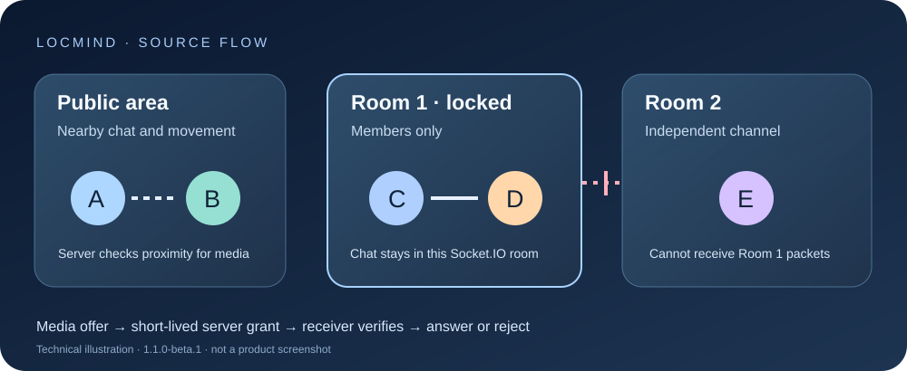

# Locmind

**A small 2D place for room-scoped conversation and collaboration.** Locmind is a Node.js, Socket.IO and Canvas prototype. People move through a shared map, create an open or password-protected room, and use room chat, notes and a whiteboard. Audio, camera and screen sharing are optional WebRTC features.



> **Source preview · 1.1.0-beta.1.** Real Socket.IO packet tests and a browser tour without media passed locally. Two-browser WebRTC calls, mobile input, deployment behind HTTPS, TURN, restart behavior and production moderation are still acceptance work. The diagram is a technical illustration, not a product screenshot.

## Try it locally

Use Node.js 24 and npm. From a clean checkout:

```bash
npm ci
npm test
npm start
```

Open `http://localhost:3000`. Enter a display name and choose **Explore silently** to try the map and chat without microphone/camera permission. Press **Enter** to chat, use **W/A/S/D** or click to move, and press **E** while standing on an empty plot to create a room. Room collaborators can open notes with **H** and whiteboard with **G**. **Q** opens local emoji assets. **Join with audio** requests microphone permission first; camera and screen sharing remain separate controls. If a room has a password, enter it at the door. Do not reuse an important password in this prototype.

`npm ci` installs a version-locked dependency tree. The browser gets PeerJS from the local server; PeerJS still uses its default external signaling service for media sessions. Opening Music Box loads the YouTube iframe API. The initial page and Explore silently mode do not request media access. [How data works](public/privacy.html) explains the network and memory behavior.

## What changed in this preview

- A private-room chat packet is sent only to sockets the **server** put in that room. Public chat reaches the public channel. Client-side visibility is no longer the privacy boundary.
- The server validates incoming event shapes, limits packet size/rates, rejects invalid room slots and caps players, rooms and music queue entries. Creating a room requires being on its empty plot. A locked room rejects unauthorized movement even if a client skips its UI.
- A media offer needs a one-use, ten-second grant bound to the caller, recipient PeerJS IDs and allowed room/proximity state. The receiving client asks the server to verify it before answering. On membership loss, the server asks both honest clients to close related calls. These controls do not erase media a participant already captured.
- Room passwords are stored as salted scrypt hashes in server memory. The socket response never includes the hash or salt. The application still has no account identity, durable data or moderation system.
- Emoji files are served from the actual `emoji/` directory. The fake agreement placeholder was removed, and the entry screen offers a no-media tour with a clear data explanation.

## Network and operational limits

The default server listens on port 3000. `PORT` changes the port; `ALLOWED_ORIGINS` is a comma-separated list of allowed browser origins and defaults to `http://localhost:3000,http://127.0.0.1:3000`. If you change the port, set the matching origin as well. The server accepts requests without an `Origin` header so CLI clients can connect; protect public deployments with an HTTPS reverse proxy, rate limiting and network policy. Room passwords are a prototype access check, not full user authentication. Reconnecting can reset per-socket rate limits.

Browser microphone and screen capture need a secure context outside localhost. PeerJS uses its public signaling service by default; no TURN server is configured, so some network pairs will fail. The server keeps positions, room content and password hashes in memory only. Restarting loses them. There is no persistence, horizontal scaling, historical recovery or automatic audit log. [Security reporting](SECURITY.md) and [support gates](docs/SUPPORT.md) describe the remaining checks.

## Development and evidence

`npm test` uses real local Socket.IO clients to check room isolation, locked movement, invalid payloads, media grant/replay protection and the emoji endpoint; it also syntax-checks the shipped inline script. Tests do **not** establish real WebRTC media interoperability. The repository includes a lockfile, a Linux/Windows CI test workflow, [changelog](CHANGELOG.md), [contribution guide](CONTRIBUTING.md) and [MIT license](LICENSE). The earlier gameplay screenshot [Locmind.png](Locmind.png) shows an older UI; it is not evidence of the current security behavior.

## Türkçe

Locmind, 2B ortak alan, oda sohbeti, not ve beyaz tahta içeren bir kaynak prototipidir. `npm ci`, `npm test`, `npm start` komutlarıyla yerelde çalıştır. **Explore silently** mikrofon/kamera izni istemeden gezinti ve sohbet sağlar. Özel oda mesajları artık yalnızca sunucunun doğruladığı üyelerin Socket.IO odasına gönderilir; medya çağrıları da kısa süreli tek kullanımlık sunucu iznine bağlıdır. Gerçek iki tarayıcılı ses/görüntü ve HTTPS/TURN dağıtım testi bitmeden ürünü güvenli genel servis olarak sunma. Depolama ve gizlilik sınırları için [veri açıklamasını](public/privacy.html) oku.
